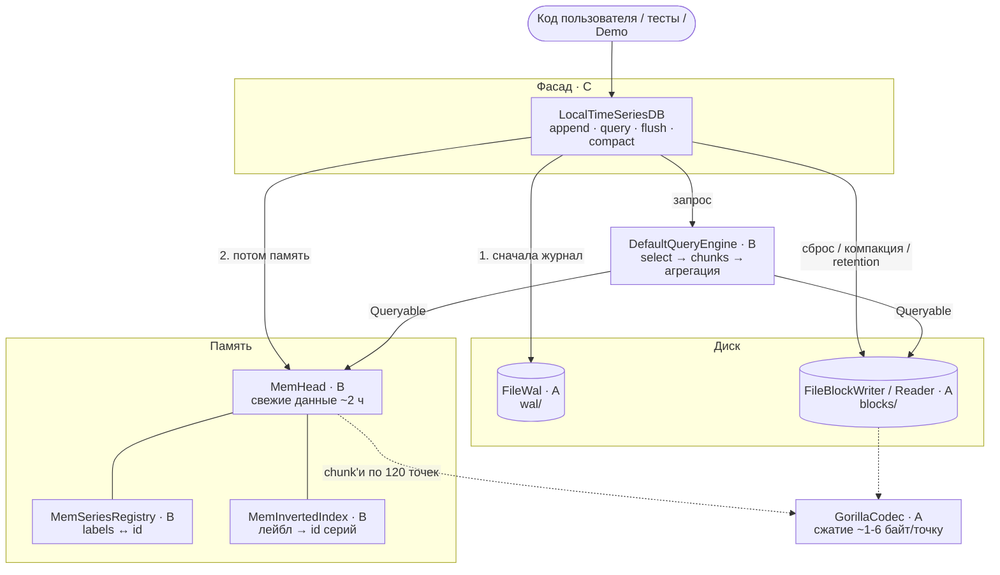
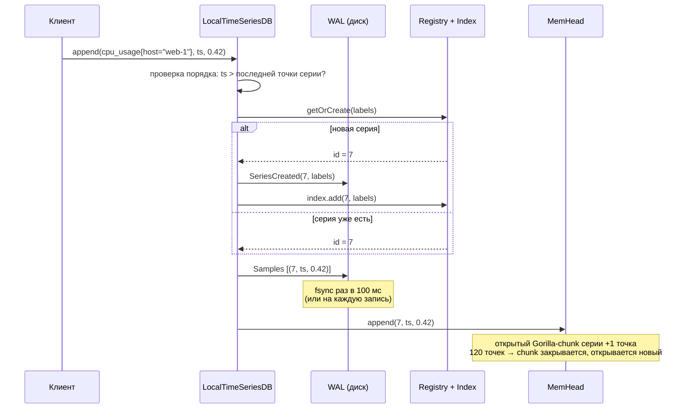
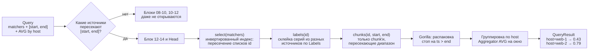
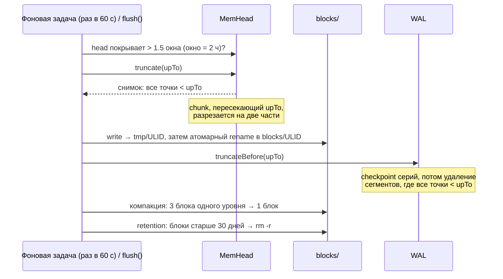
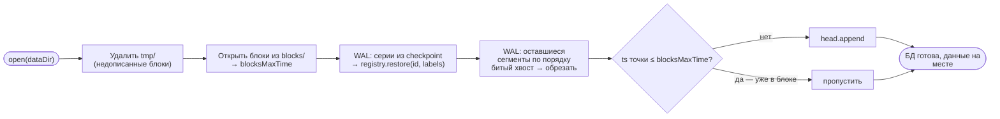

# ITMO-TimeSeriesDB

Собственная time-series база данных на Java 21 (упрощённый аналог Prometheus TSDB).

## Сборка

```
./gradlew build
```

## Quick start

Нужны Docker с `docker compose` для сервера и JDK 21 для сборки без Docker.

```
cd docker
docker compose up -d --build            # собрать образ и запустить сервер на localhost:2222
docker compose ps                       # STATUS: Up (healthy)
grpcurl -plaintext localhost:2222 list  # tsdb.v1.TimeSeriesService, grpc.health.v1.Health, ...
```

Остановить: `docker compose stop` (сервер дописывает WAL и закрывает блоки). Данные лежат в томе
`tsdb-data` и переживают перезапуски, `docker compose down -v` удаляет их вместе с томом.

Если `grpcurl` не установлен, можно взять образ: `docker run --rm --network host fullstorydev/grpcurl
-plaintext localhost:2222 list` (на macOS и Windows вместо `localhost` — `host.docker.internal`).

Без Docker:

```
./gradlew :tsdb-server:installDist
TSDB_DATA_DIR=./data tsdb-server/build/install/tsdb-server/bin/tsdb-server
```

| Модуль | Что внутри |
|---|---|
| `tsdb-core` | движок БД: все пакеты из таблицы ниже |
| `tsdb-proto` | `tsdb.proto` и сгенерированные из него классы и gRPC-stub'ы |
| `tsdb-server` | gRPC-сервер поверх фасада, `ServerConfig` |
| `tsdb-cli` | клиент для записи, чтения и нагрузки |
| `buildSrc` | общие настройки Gradle для всех модулей (`tsdb.java-conventions`) |
| `docker/` | `Dockerfile`, `docker-compose.yml` |

Сервер настраивается переменными окружения, в compose — блок `environment`:

| Переменная | По умолчанию | Что задаёт |
|---|---|---|
| `TSDB_PORT` | `2222` | порт gRPC |
| `TSDB_DATA_DIR` | `data`, в образе `/data` | каталог с WAL и блоками |
| `TSDB_BLOCK_RANGE_MS` | `7200000` (2 ч) | окно блока |
| `TSDB_RETENTION_MS` | `2592000000` (30 дней) | срок хранения блоков, `0` — хранить вечно |
| `TSDB_WAL_SYNC_INTERVAL_MS` | `100` | fsync WAL раз в N мс, `0` — на каждую запись |
| `TSDB_COMPACTION_INTERVAL_MS` | `60000` | период фонового сброса head, компакции и retention, `0` — выключено |
| `JAVA_OPTS` | в образе `-XX:MaxRAMPercentage=75` | флаги JVM |

## Example usage

Через `grpcurl` (reflection на сервере включён, `.proto` передавать не нужно):

```
# записать две точки серии cpu_usage{host="web-1"}
grpcurl -plaintext -d '{"series":[{
    "labels":[{"name":"__name__","value":"cpu_usage"},{"name":"host","value":"web-1"}],
    "samples":[{"timestamp_ms":1760000000000,"value":0.41},{"timestamp_ms":1760000015000,"value":0.43}]}]}' \
  localhost:2222 tsdb.v1.TimeSeriesService/Write
# {"accepted": "2"}

# сырые точки
grpcurl -plaintext -d '{"matchers":[{"name":"__name__","value":"cpu_usage"}],
    "start_ms":0,"end_ms":9999999999999}' \
  localhost:2222 tsdb.v1.TimeSeriesService/Query

# среднее по каждому host в окнах по минуте; type: EQ (по умолчанию), NEQ, RE, NRE
grpcurl -plaintext -d '{"matchers":[{"name":"__name__","value":"cpu_usage"},{"type":"RE","name":"host","value":"web-.*"}],
    "start_ms":1760000000000,"end_ms":1760000060000,"aggregation":"AVG","group_by":["host"],"step_ms":60000}' \
  localhost:2222 tsdb.v1.TimeSeriesService/Query

grpcurl -plaintext localhost:2222 tsdb.v1.TimeSeriesService/LabelNames
grpcurl -plaintext -d '{"name":"host"}' localhost:2222 tsdb.v1.TimeSeriesService/LabelValues
grpcurl -plaintext localhost:2222 tsdb.v1.TimeSeriesService/GetStats   # серии, блоки, точки в head, байты на диске
grpcurl -plaintext localhost:2222 tsdb.v1.TimeSeriesService/Flush      # сбросить head в блок
```

Через CLI:

```
./gradlew :tsdb-cli:installDist
alias tsdb-cli=tsdb-cli/build/install/tsdb-cli/bin/tsdb-cli

tsdb-cli --addr localhost:2222 write 'cpu_usage{host="web-1"}' 0.42     # ts = сейчас
tsdb-cli query 'cpu_usage{host=~"web-.*"}' --start -1h --agg avg --by host --step 1m
tsdb-cli load --series 1000 --interval 15s --duration 10m                # генератор нагрузки
tsdb-cli stats
```

Подтверждённые записи переживают `kill -9`: после рестарта сервер поднимает их из WAL.

```
cd docker
docker compose kill          # SIGKILL, shutdown hook не успевает
docker compose up -d
tsdb-cli query 'cpu_usage{host=~"web-.*"}' --start -1h --agg avg --by host   # данные на месте
```

## Пакеты и владельцы

| Пакет | Что внутри | Владелец |
|---|---|---|
| `org.tsdb.model` | Labels, Sample, Series, Matcher, Query, исключения | B |
| `org.tsdb.encoding` | BitWriter/BitReader, Chunk, Gorilla | A |
| `org.tsdb.index` | SeriesRegistry, InvertedIndex, Postings | B |
| `org.tsdb.wal` | Write-ahead log | A |
| `org.tsdb.head` | In-memory head | B |
| `org.tsdb.block` | Блоки на диске | A |
| `org.tsdb.compact` | Компакция, retention | A |
| `org.tsdb.query` | Queryable, QueryEngine, агрегации | B |
| `org.tsdb.db` | Фасад TimeSeriesDB, DbOptions | C |

A — Storage, B — Index & Query, C — API & Infra.

## Лаба 2

БД — библиотека внутри Java-процесса: открыл каталог, пишешь, читаешь, закрыл, открыл снова — данные
на месте. Сети пока нет (она в лабе 3).

### Компоненты



Главная идея: `Head` и `Block` реализуют один интерфейс `Queryable`, поэтому `QueryEngine` читает
память и диск одинаково и не знает, где лежат данные. В лабе 5 так же подключится удалённый шард.

### Путь записи



Порядок «журнал → память» гарантирует: всё, что попало в память, уже есть на диске в WAL и переживёт падение.

### Путь чтения

Запрос: `avg cpu_usage{host=~"web-.*"} by (host)` за последний час.



Как индекс находит серии (`select`):

```
__name__="cpu_usage"  → [1, 2, 3, 4]
host=~"web-.*"        → union([1, 2, 5], [3]) = [1, 2, 3, 5]
                         ─────────────────────────────────────
пересечение           → [1, 2, 3]        ← chunk'и остальных серий не читаются вовсе
```

### Жизнь данных: память → блок → компакция → удаление



Разрезка chunk'а на границе блока (`upTo = 1000`):

```
серия web-1:   [100 ··· 400]  [500 ··· 900]  [950 ··· 1100]  [1200 ··· 1500]
                    │              │           │       │            │
                 в блок         в блок      [950]   [1100]      остаётся
                                            в блок  в head      в head
```

Gorilla сжимает потоком, байты из середины chunk'а сами по себе ничего не значат, поэтому
пересекающий chunk распаковывается и упаковывается заново двумя кусками. Итог — строгое правило:
**в блоке всё < upTo, в head всё ≥ upTo**. На нём держится восстановление после падения.

### Что лежит на диске

```
data/
├── wal/                          журнал: страховка для данных из памяти
│   ├── 00000007                  сегменты по 8 МБ: [длина][crc32][запись]...
│   ├── 00000008                  ← активный, сюда дописываются записи
│   └── checkpoint.00000008       все серии (id + labels) — нужен после удаления старых сегментов
├── blocks/                       неизменяемые блоки, каждый — окно времени
│   ├── 01M4RKMBW0EV3J0TXWB8Z7NDDH/
│   │   ├── meta.json             minTime, maxTime, число серий/точек, уровень компакции
│   │   ├── index                 серии блока и ссылки на их chunk'и
│   │   └── chunks.bin            Gorilla-chunk'и подряд
│   └── 01M4RM2WZ0PA3VJB2YNQ0KJ047/
└── tmp/                          блок пишется сюда и атомарно переносится в blocks/
```

### Восстановление после падения



## Демо и бенчмарк

```
./gradlew demo                                  # 1000 серий за 4 часа → блок → запрос avg by host
./gradlew bench                                 # 1000 серий × 15 с × 24 ч = 5.76M точек
./gradlew bench -PbenchArgs="hours=2 warmup=0"  # быстрый прогон; ещё hosts, cores, stepMs, queries
```

Данные — `org.tsdb.bench.MetricsGenerator`: серии `cpu_usage{host, core}`, значение — случайное
блуждание в [0, 1] с шагом до ±0.02 и округлением до 0.01. 

Для Gorilla это неудобные данные:
значение меняется почти в каждой точке, а десятичные дроби после XOR дают много значащих бит.
Сценарий прогоняется 3 раза (2 — прогрев JIT), цифры по последнему прогону.

Результат (JDK 26, Windows 11, `./gradlew bench`):

| Метрика | Значение |
|---|---|
| Запись (`appendBatch` по 1000 точек, включая flush и compact) | ~815 000 точек/с (7.1 с на 5.76M) |
| Блоки на диске | 32.7 МБ = **5.68 байт/точку** (без сжатия — 16) |
| Весь каталог данных (с WAL и checkpoint'ом серий) | 32.8 МБ, сжатие 2.8x |
| Запрос avg by host за последний час по 100 сериям | ~3 мс (медиана из 50) |
